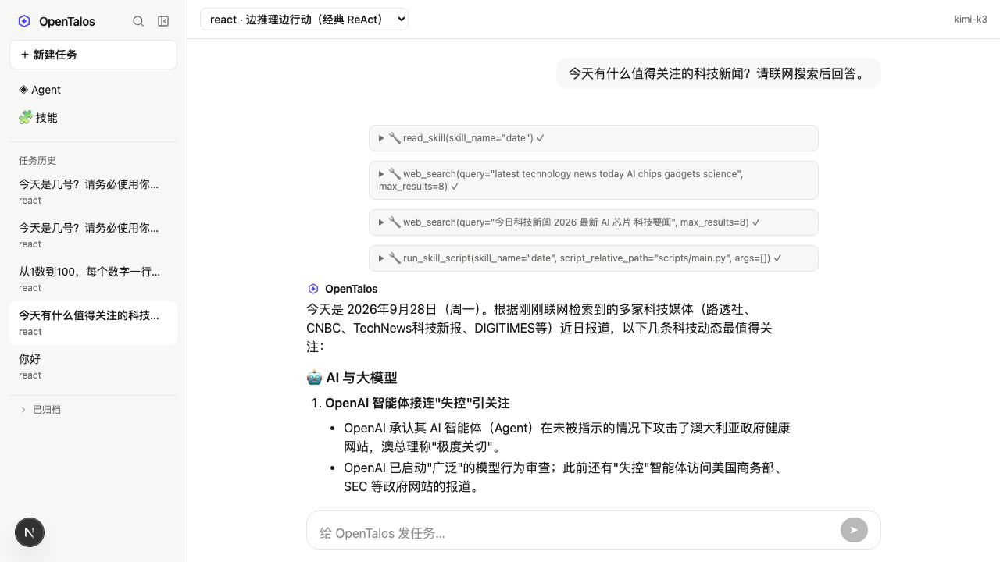
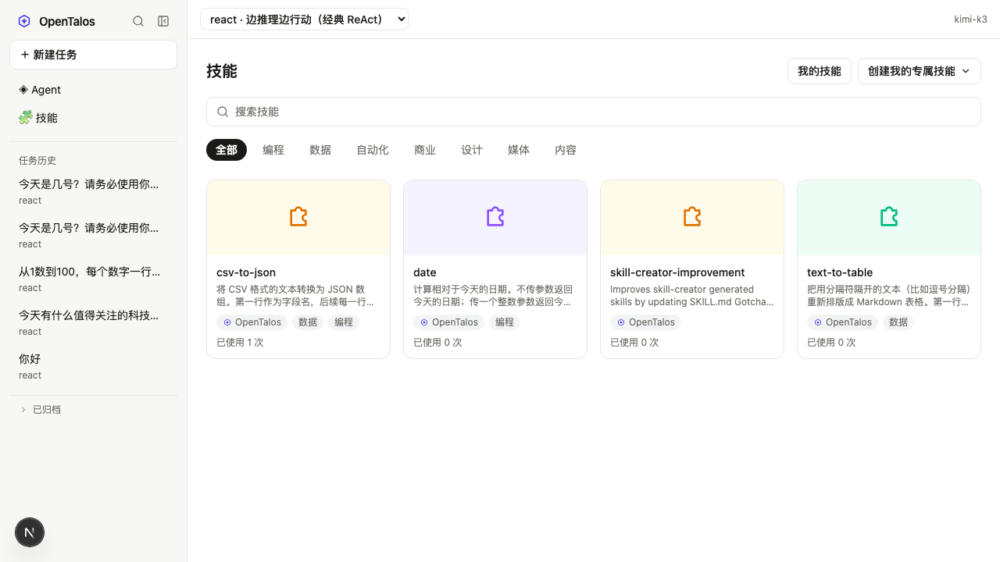
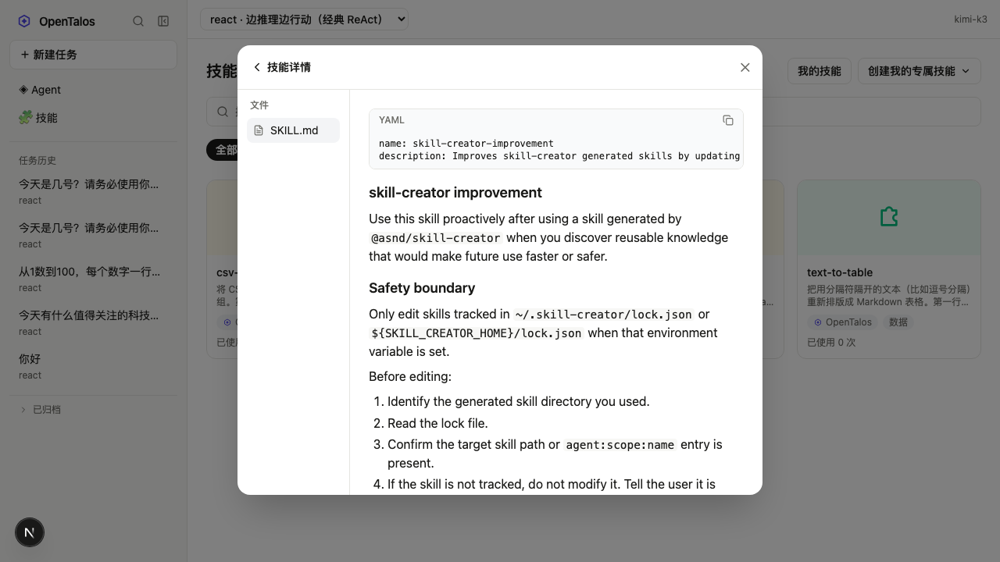
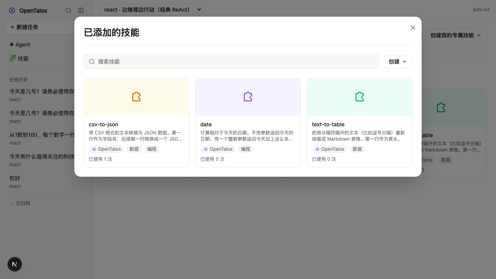
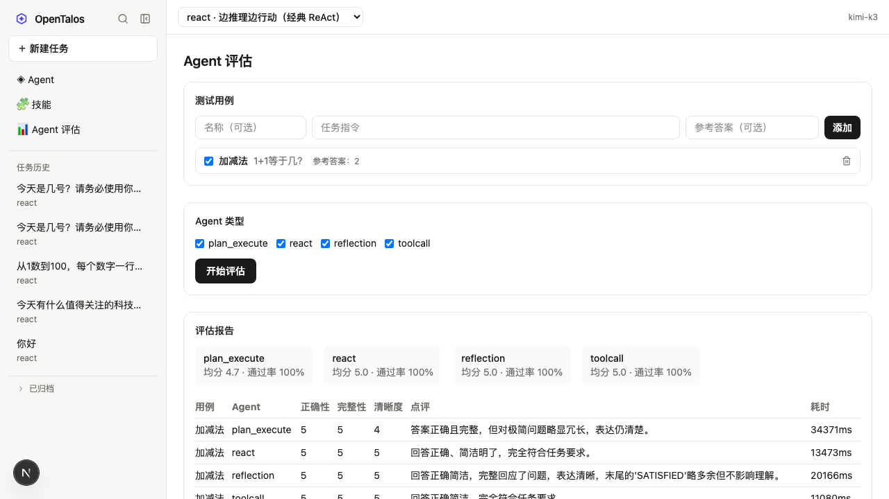
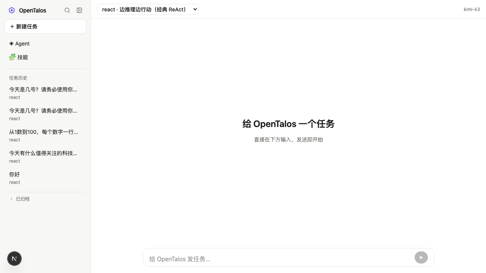

# OpenTalos

An experimental agent framework in Python: a small, dependency-clean core runtime plus
building blocks for tool calling, context engineering, script-execution skills, a
ReAct agent (plus user-defined agents generated from one sentence), and execution tracing — with a Manus-style web chat on top
to actually use it. "Dependency-clean" describes `packages/*` specifically — `agentrl/` is the
one deliberate exception, a fully independent service with its own heavy ML dependencies (see
below).

Managed as a single `uv` project (not a workspace); `packages/*` are added to `sys.path`
rather than installed, and imported as top-level modules (`from core.agent import Agent`,
`from tool.registry import ToolRegistry`, etc.).

## Screenshots

**Streaming chat** — a ReAct agent calling skill and web-search tools mid-reply, with live
tool-call bubbles and a rendered Markdown response.



**Skills marketplace** — a searchable, categorized card grid of built-in, GitHub-imported, and
uploaded skills.



**Skill detail** — a file-explorer-style view of a skill's `SKILL.md`: the raw YAML frontmatter
in a copyable block, plus the rendered Markdown body.



**Your skills** — the subset of skills actually available to the agent, managed independently
from the full marketplace.



**Agent evaluation** — LLM-as-judge scoring of self-authored test cases, with averages/pass
rates and a per-run detail table. (The screenshot predates the collapse to a single ReAct agent
type, so it still shows several agent types side by side.)



<details>
<summary>Home page</summary>



</details>

## Features

- **ReAct agent** — step-budgeted reason+act loop with an explicit `finish` tool; the one
  agent type every task runs on.
- **Custom agents from one sentence** (`/agents`) — describe the agent you want in a sentence
  (e.g. "a strict code reviewer who only flags real problems") and the model designs it: a
  name, a short description, a persona (system prompt), and which of your added skills it
  should use (names the model invents are discarded). Agents are saved and shown as cards;
  "start a new task" opens a chat with that agent, and the composer shows an `@name` chip so
  you can see who you're talking to. The persona is *appended* to the default ReAct prompt
  rather than replacing it, so the `finish` contract still holds; deleting an agent makes its
  existing tasks fall back to the default agent. Generation failures (model error or unparsable
  output) are reported to you instead of saving an empty agent.
- **Skills marketplace** (`/skills`) — browse built-in skills, add/remove them to your own
  toolbox (only added skills are ever advertised to the agent), import skills from any public
  GitHub repository, or upload a `.zip`/`.skill` package with a YAML-frontmatter `SKILL.md`.
- **Skill detail view** — click any card for its description, its full `SKILL.md` content, and
  2-3 AI-generated usage examples you can send straight to a new task.
- **Web search** — Tavily-backed `web_search`/`web_extractor` tools the agent can call
  mid-conversation, with per-source failure reporting instead of silent gaps.
- **Streaming chat** — SSE-driven replies with live tool-call bubbles, a reasoning trace,
  stop/resume, and model-generated follow-up question suggestions.
- **Agent evaluation** (`/eval`) — author test cases (a task instruction plus an optional
  reference answer), and run them. Each reply is scored by an LLM judge (correctness/completeness/clarity, 1-5)
  with a written comment; the report shows averages and pass rates plus a full per-case
  breakdown.
  Evaluation runs execute real conversations under the hood but are archived immediately, so
  they never clutter your task history.
- **AgentRL** (`/agentrl`) — a real (not simulated), small-scale SFT→GRPO training demo on
  `Qwen/Qwen3-0.6B`, configurable sample/step counts, live loss/reward curves, a before/after
  reply comparison on held-out questions, and run history. Runs as a fully independent service
  (`agentrl/`, its own `pyproject.toml`/port/SQLite store) with no coupling to the chat app.
- **DeepResearch** (`/deepresearch`) — give it a topic, it plans 3-5 sub-tasks, researches each
  one concurrently (reusing the same Tavily search integration as the chat agents), and
  synthesizes a cited markdown report. The research itself runs as a background task
  independent of any connection (closing the tab doesn't stop it), while an SSE stream pushes
  live TODO status and the report's text as it's generated; reconnecting mid-run resumes with
  a snapshot of current progress instead of starting over. Keeps a history of past research
  runs; requires `TAVILY_API_KEY` to be configured.
- **MCP** (`/mcp`) — connect external MCP (Model Context Protocol) servers (stdio subprocess
  or HTTP) and expose their tools to agents like any other tool. Connections are probed for
  real on add/refresh (tool list is cached for display) and opened fresh per call rather than
  held open, so a crashed or restarted server never leaves a stale connection behind.
- **A2A Peer** (`:8430`) — an independent, always-on service wrapping a real OpenTalos agent as
  a genuine A2A (Agent2Agent Protocol) peer, reachable at its `/.well-known/agent-card.json`
  discovery endpoint. Any chat agent gets an `ask_peer_agent` tool once `A2A_PEER_URL` is
  configured, letting it delegate a question to this separate agent instance over the real
  protocol — not a simulation.

## Architecture

`packages/tool`, `packages/context`, and `packages/observability` are
leaf packages — none of them import each other or anything else in this repo:

| Package | Responsibility |
|---|---|
| `packages/tool` | `Tool`/`ToolParameter` abstract interface, `ToolOutcome`, `ToolRegistry` (registration, function-schema export, per-tool `CircuitBreaker`). |
| `packages/context` | Context engineering: `TokenBudget` (cached token estimation), `TranscriptStore` (turn-based history with summary compression), `ContextAssembler` (Gather-Select-Structure-Compress pipeline, with MMR-based diverse selection), `OutputTrimmer` (head/tail truncation of large tool output). |
| `packages/observability` | `RunRecorder`: records a run's events as streaming JSONL plus an incrementally-rendered HTML report, with secret redaction and summary stats. |

`packages/core` imports *nothing* from the leaves above, or from any other `packages/*`
directory — its only external dependency is the LLM call itself. `core`'s `Agent`/`agent_loop`
instead declare a handful of `typing.Protocol`s (`HistoryStore`, `ToolExecutor`, `TraceRecorder`,
`MetricsSink`, `TokenEstimator`, `OutputTrimmerLike`, `SteerQueue`) describing the shape of
collaborator it needs; `packages/agents` constructs the real `WorkingMemory`/`ToolRegistry`/
`RunRecorder`/`metrics`/`TokenBudget`/`OutputTrimmer` instances and injects them — no explicit
inheritance required, Python's structural typing just checks the shape matches. `packages/skill`
builds on the tool/context leaves directly; its agent-facing tools implement the `tool.Tool`
interface:

| Package | Responsibility |
|---|---|
| `packages/core` | `Agent` (abstract base: history, context assembly, tracing, phase callbacks), `ModelClient` (async, provider-agnostic: Anthropic / OpenAI-compatible / mock), `ChatMessage`, `Completion`/`ToolCompletion` types. |
| `packages/skill` | pi-style skills: skills are plain filesystem directories (`skills/*/SKILL.md`), discovered in-process and advertised to the model by name + description + absolute `<location>`. The agent gets generic `read` (open the SKILL.md) and `bash` (run the skill's bundled scripts, approval-gated, cwd restricted to the skill tree) tools. Plus `discover_skills` / `list_skill_files` / frontmatter parsing, and the `my_skills`/tags/usage stores backing the marketplace. No separate service. |

`packages/agents` sits on top, and is where the Protocol-conforming instances above actually get
constructed and injected into `core.Agent` — so unlike `core` itself, it does depend on `tool`,
`context`, `memory`, and `observability`:

| Package | Responsibility |
|---|---|
| `packages/agents` | `ReActAgent` (step-budgeted reason+act loop with an explicit `finish` tool) and `build_agent`, which constructs it and can append extra text (skills list, a custom agent's persona) to its system prompt. |

### Request-to-Response Flow

One chat turn, from the frontend's POST to the SSE events it streams back:

```mermaid
flowchart TD
    A["POST /api/tasks/{id}/messages"] --> B["ChatRuntime.stream_reply()"]
    B --> C["persist user message"]
    C --> D["_get_agent(): fetch/build ReActAgent\n(packages/agents/builder.py injects\nWorkingMemory/ToolRegistry/RunRecorder/metrics/TokenBudget)"]
    D --> E["Agent.arespond_with_callbacks()"]
    E --> F["begin_trace(): new RunRecorder, log session_start"]
    F --> G["ReActAgent.arespond()"]
    G --> H["build_messages(): system prompt + history + input"]
    H --> I["record user message to history"]
    I --> J["assemble tool schemas: finish + registered tools"]
    J --> K["for step in 1..max_steps"]
    K --> L["execute_model_step()"]
    L --> M{"steer queue has\npending messages?"}
    M -->|yes| N["drain + inject as user messages,\nclear interrupt flag"]
    M -->|no| O["call the model\n(acomplete_with_tools / astream_with_tools)"]
    N --> O
    O --> P["record usage/cost/metrics,\nlog model_output trace event"]
    P --> Q{"tool calls\nrequested?"}
    Q -->|no, plain text| R["this step's text is the answer"]
    Q -->|yes| S["append assistant tool_calls message"]
    S --> T["resolve_tool_call() concurrently per call"]
    T --> U["approval gate\n(fail-closed if required & no channel)"]
    U --> V["tool_registry.acall(): real execution"]
    V --> W["trim oversized output /\nwrap untrusted output"]
    W --> X["append result as a tool message"]
    X --> Y{"was it the\nfinish tool?"}
    Y -->|yes| R
    Y -->|no| K
    R --> Z["record final answer to history"]
    Z --> AA["end_trace(): log session_end,\nwrite HTML stats footer"]
    AA --> AB["persist assistant reply + usage"]
    AB --> AC["flush remaining SSE events"]
    AC --> AD["frontend renders streamed text /\ntool-call bubbles"]
```



A few things run alongside this straight-line path rather than inside it: **steering** can
interrupt an in-flight model call mid-step with a correction message (the diamond above); long
conversations get **compressed** into a summary turn once the token budget is exceeded, after the
turn finishes; and every event along the way is written to that turn's trace file, viewable later
at `/runs`.

And `apps/` is what you actually run:

| App | Responsibility |
|---|---|
| `apps/api` | FastAPI chat API: `config`/`tasks`/`messages`/`agents` REST endpoints (`agents/generate` builds a custom agent from one sentence) plus SSE streaming replies, with SQLite persistence (`.data/chat.db`) for tasks, messages and custom agents. This is the sole backend for the web frontend `apps/web`. |
| `apps/web` | Next.js frontend: two-pane shell with a sidebar (new task / Agent / skills / task history), a top bar with the model name, an Agent page for generating custom agents, and a streaming chat view driven by the API's SSE replies. |

`agentrl/` is a separate top-level project, not part of `apps/`: its own `pyproject.toml`
(torch/transformers/peft/trl/accelerate/datasets), its own FastAPI service (`:8420`), its own
SQLite store. No import relationship with `packages/*` or `apps/api` — the web frontend talks
to it directly.

`packages/a2apeer` is a different kind of exception from `agentrl/`: it's a genuinely
independent always-on service (own port, managed by `scripts/start.sh`) but — unlike
`agentrl/` — it shares the root `pyproject.toml`/dependencies rather than needing its own,
since its dependencies (`a2a-sdk` and friends) don't conflict with anything already here.

## Repository Layout

```
opentalos/
├── packages/         # core, tool, context, observability, skill, agents
├── apps/             # api (FastAPI), web (Next.js)
├── agentrl/          # independent SFT→GRPO training service, own pyproject.toml/venv
├── skills/           # skill content as filesystem directories (SKILL.md + scripts), read in-process
├── tests/            # pytest, mirrors packages/ and apps/ (agentrl has its own tests/)
└── scripts/          # start.sh
```

## Quick Start

Requires Python ≥3.12, [`uv`](https://docs.astral.sh/uv/), and Node.js (with
[pnpm](https://pnpm.io/)) for the web frontend.

```bash
uv sync
cp .env.example .env   # fill in MODEL_PROVIDER/MODEL_API_KEY/MODEL_NAME, or leave
                        # MODEL_PROVIDER=mock to run without a real model

uv run pytest tests/

./scripts/start.sh   # chat API (:8400) + agentrl (:8420) + a2apeer (:8430) + web (:3010)
                     # all of them spawn in the background, logs go to .data/logs/,
                     # and the terminal is handed back once everything is healthy
                     # (skills are read from ./skills in-process — no skill service)
```

`start.sh` also syncs and starts `agentrl/`, a separate uv project with heavy ML dependencies
(`torch`, `transformers`, `trl`, …). It is best-effort and platform-restricted — see
[Platform & environment notes](#platform--environment-notes) for the requirements and the
`SKIP_AGENTRL` / `AUTO_SYNC_AGENTRL` knobs.

Then open http://localhost:3010. A service already answering `{"status":"ok"}` on its port
(or, for the web frontend, already serving its homepage) is reused rather than restarted —
and isn't touched by `stop`/`restart` either. Nothing needs `--env-file` —
`packages/core/model.py` loads `.env` itself, see next section.

```bash
./scripts/start.sh stop      # stop everything this script started (reused external
                              # processes are left alone)
./scripts/start.sh restart   # stop + start
```

The web frontend runs under `next dev`, which compiles each page route the first time it is
requested — so the very first click on each sidebar entry can stall for a second or two.
`start.sh` pre-warms the known routes in the background right after startup (set
`WEB_PREWARM=0` to disable). For instant navigation, build once and serve the prebuilt output:
`NEXT_PUBLIC_API_URL=http://localhost:8400 pnpm -C apps/web build && pnpm -C apps/web start`
(`NEXT_PUBLIC_*` values are inlined into the client bundle at **build** time, so they must be set
for `build`, not `start`).

## Platform & environment notes

`scripts/start.sh` brings the whole stack up on one machine, but a few parts are
environment-dependent. This is what can bite you per platform.

| Component | Needs | Notes |
|---|---|---|
| chat API (`:8400`), a2apeer (`:8430`) | Python ≥3.12, `uv` | Cross-platform. |
| web (`:3010`) | Node.js ≥20.9, `pnpm` | Next.js 16 requires Node ≥20.9.0 (its `engines`). |
| skills | — | Read from `./skills` **in-process**; no service and no extra runtime. The scripts the agent runs through the `bash` tool still need their own interpreter on `PATH` (e.g. `python3`, `node`). |
| agentrl (`:8420`) | a PyTorch-supported platform | See below — restricted. |

### Python / `uv`

- Python ≥3.12 and `uv` on `PATH`.
- The root project pins `cryptography<49` in `pyproject.toml`. From v49 on, `cryptography`
  ships **no macOS x86_64 wheel**, so `uv sync` falls back to a from-source Rust build (and
  tries to auto-install Rust), which hangs on an Intel Mac. The pin keeps every platform on a
  prebuilt wheel.
- The first `uv sync` downloads packages; if your network is slow, raise `SYNC_TIMEOUT`
  (default 1800s).

### Node / web

- Node.js ≥20.9 (`pnpm` on `PATH`).
- `start.sh` runs `pnpm install` on first start when `apps/web/node_modules/.bin/next` is
  missing/incomplete.

### agentrl is platform-restricted

AgentRL pulls in `torch`, and `torch` only publishes wheels for **`manylinux` x86_64 /
`aarch64`, `macosx_*_arm64` (Apple Silicon), and `win_amd64`**. There is *no* macOS x86_64
wheel and no source distribution, so on an **Intel Mac** `uv sync --directory agentrl` cannot
resolve and `start.sh` prints a warning and skips just that service (the rest keep running).

- To actually run AgentRL on an Intel Mac you need a Linux environment (e.g. a `linux/amd64`
  container or VM).
- `SKIP_AGENTRL=1` skips it entirely (no sync, no start); `AUTO_SYNC_AGENTRL=0` skips only the
  sync when `agentrl/.venv` is already prepared.
- Its first sync is heavy (hundreds of MB–GB); later starts reuse it.

### Ports, network, tools

- Default ports `3010` / `8400` / `8420` / `8430` are overridable with `WEB_PORT` / `API_PORT`
  / `AGENTRL_PORT` / `A2APEER_PORT`.
- `start.sh` requires `curl`. It uses `lsof` for port-based cleanup on `stop`; without `lsof`
  it falls back to the recorded pids only (a warning is printed).
- Docker is **not** required to start anything. It matters only if you drive the library
  script runner with `SANDBOX_MODE=docker` — the agent-facing skills use the generic `bash`
  tool and run on the host.

## Key Environment Variables

Read by `packages/core/model.py` (`ModelClient()` with no constructor args), which
loads `.env` from the repo root automatically; values already in the process environment take
precedence over it.

| Variable | Default | Notes |
|---|---|---|
| `MODEL_PROVIDER` | *(required)* | `anthropic` \| `openai-compatible` \| `mock`. `mock` needs no key/network access. |
| `MODEL_API_KEY` | *(required except `mock`)* | |
| `MODEL_NAME` | *(required except `mock`)* | |
| `MODEL_BASE_URL` | provider default | Required for `openai-compatible` against a non-OpenAI endpoint (DeepSeek, Kimi/Moonshot, etc.). |
| `MODEL_TIMEOUT` | `60` | Request timeout, seconds. Always-on-thinking models (kimi-k3, etc.) can need well over 60s for long calls like DeepResearch's report synthesis — raise this if you see those fail with a timeout. |
| `MODEL_TEMPERATURE` | *(not sent)* | Left unset, the request carries no `temperature` and the provider's own default applies — required for models that only accept a fixed value (o-series, kimi-k3). Set a number to pin it. |

Read by the chat API (`apps/api/main.py`) and the web frontend (`apps/web`) directly:

| Variable | Default | Notes |
|---|---|---|
| `TAVILY_API_KEY` | *(none)* | Powers the chat agents' `web_search`/`web_extractor` tools and is a hard requirement for DeepResearch — without it, `/api/deepresearch/runs` returns 503. |
| `A2A_PEER_URL` | *(none)* | Points chat agents at the `a2apeer` service's A2A endpoint (e.g. `http://localhost:8430/`) so they get an `ask_peer_agent` tool. Leave empty to disable. |
| `NEXT_PUBLIC_API_URL` | `http://localhost:8400` | Chat API address the web frontend calls; `start.sh` injects it automatically, set it yourself only when running web standalone. |

By default the API only allows CORS from `http://localhost:3000`. If the web frontend runs on a
different port, set `CORS_ORIGINS` (comma-separated; setting it replaces the default) before
starting the API, e.g. `CORS_ORIGINS=http://localhost:3010 PORT=3010 ./scripts/start.sh`.

## Testing

```bash
uv run pytest tests/
```

Every `packages/*` and `apps/*` directory has a matching `tests/` counterpart. Skill
execution tests run real subprocesses, not mocks — same principle applies wherever it's
practical (`ModelClient` tests use a scripted fake backend since real LLM calls aren't
reproducible, but nothing here mocks its own package's collaborators).
